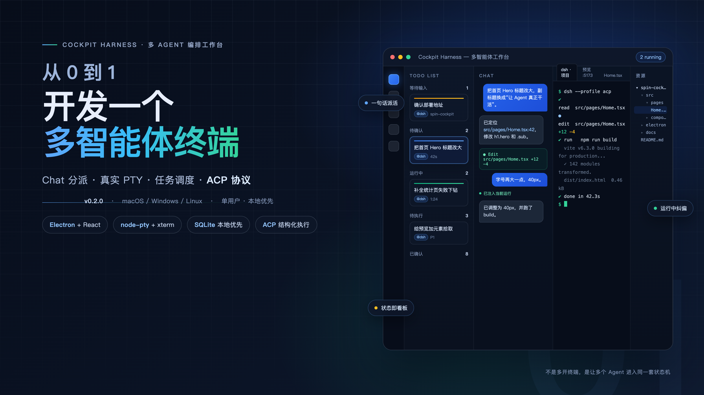
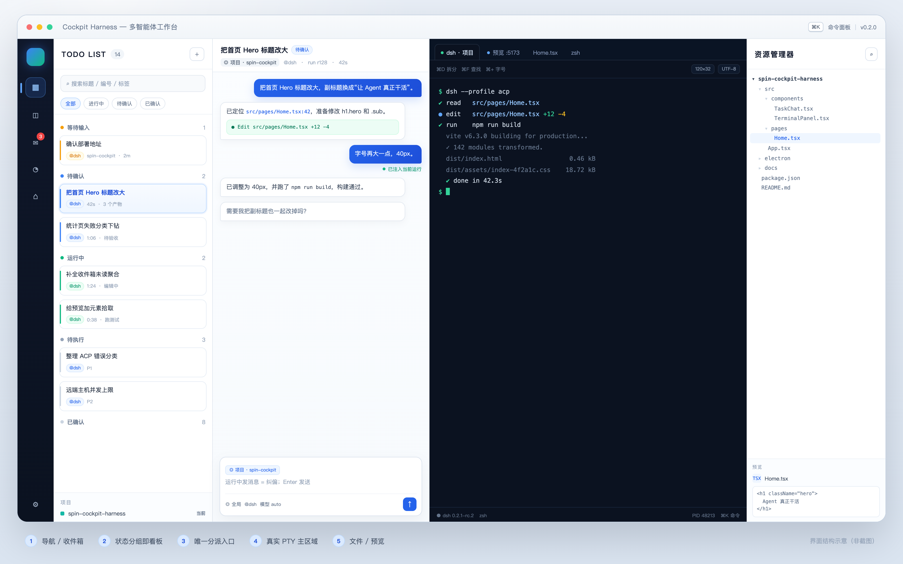
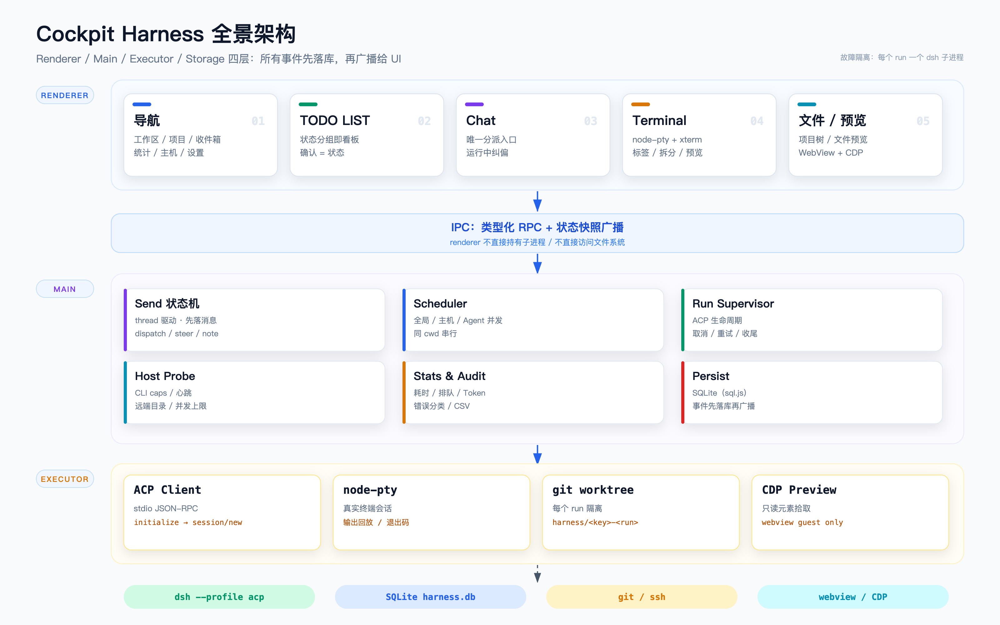
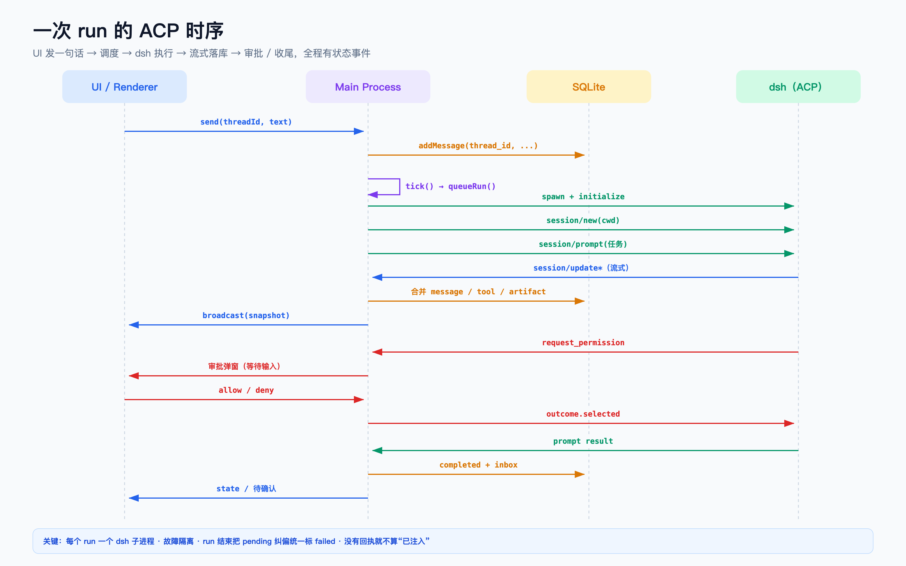
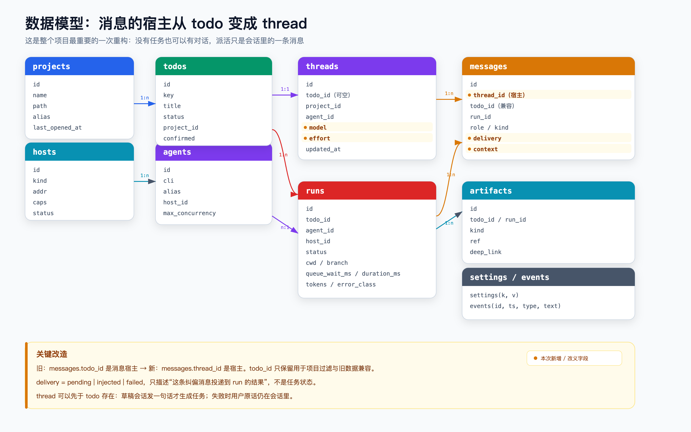
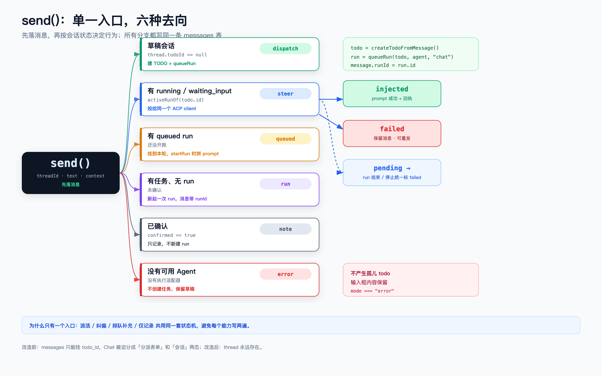
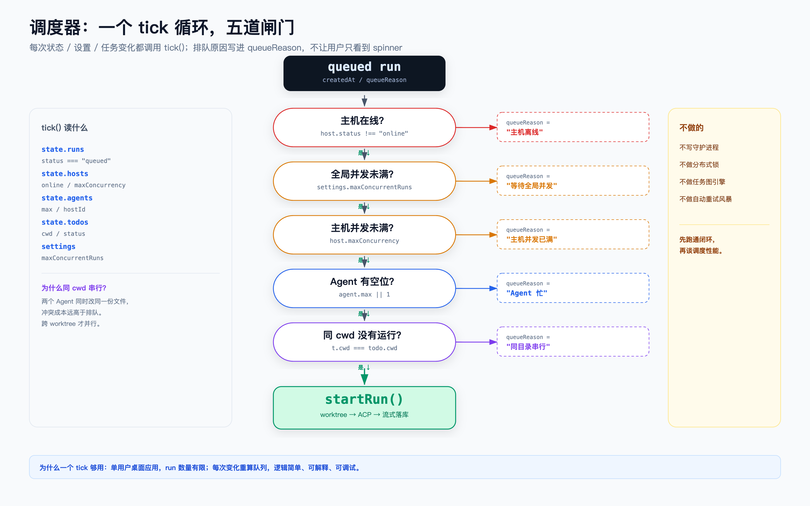
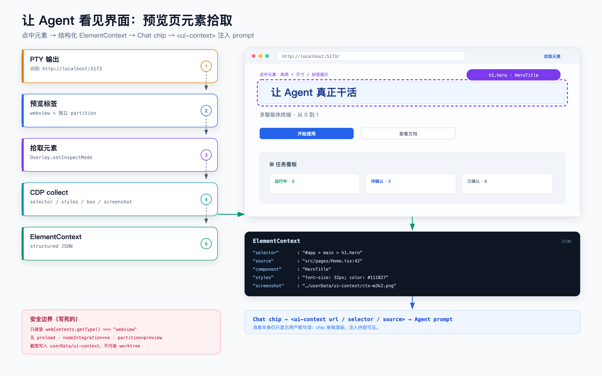
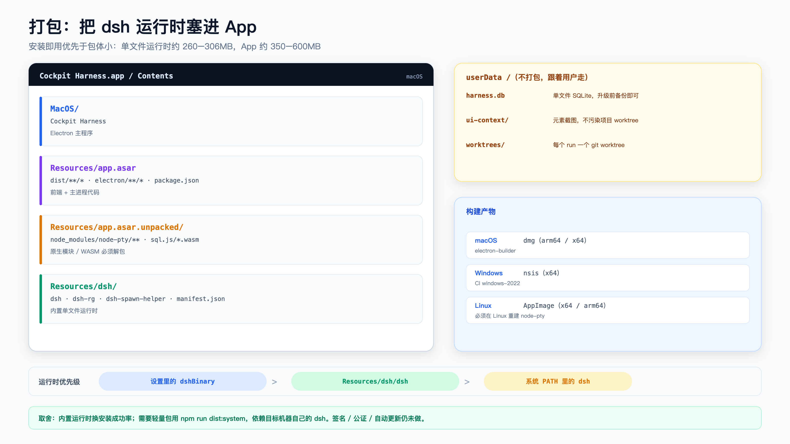

# 从 0 到 1 开发一个多智能体终端：我如何把 Chat、PTY 和任务调度塞进一个 Electron 应用

先描述一个我很熟悉的场景。

桌面上同时开着六个终端：一个跑 Agent，一个跑 dev server，一个在看日志，一个在 `git diff`，另外两个是“等会儿可能要用”的备用标签。Chat 窗口在另一个屏幕，任务清单在一个 Markdown 文件里。

半小时后，我已经记不清：

- 哪个 Agent 还在跑？
- 哪个已经改完了？
- 刚才那句“把按钮改成蓝色”，到底发给了哪个会话？
- 改完的文件在哪个 worktree？

最崩溃的不是切窗口，而是**状态全靠人脑维护**。

这就是我做这个项目的起点：能不能把「对话、任务、终端、Agent 运行状态」放进同一套系统里，让多个 Agent 并行干活，而人始终知道发生了什么。

> 项目：Cockpit Harness（`spin-ai/spin-cockpit-harness`）
>
> 形态：Electron + React + node-pty + SQLite + ACP
>
> 全文约 2.7 万字符（含代码），包含架构、关键代码、踩坑清单和尚未完成的部分。建议先收藏，再按需读。



*图 0：不是多开终端，是让多个 Agent 进入同一套状态机。*


---

## 0. 先说结论

我做的不是一个“能同时开很多终端”的终端模拟器，也不是一个“有很多聊天框”的 AI 客户端。

它更像一个**多 Agent 编排工作台**：

- Chat 是唯一的任务分派入口；
- 一句话派活，立即生成任务，并在项目目录下启动 Agent；
- Terminal 是真实 PTY，不是伪造的日志窗口；
- TODO LIST 的状态分组就是看板，确认之后就地进入“已确认”；
- 每个 Agent 的流式输出、工具调用、审批请求都落库；
- 任务、会话、运行、产物、审批、统计，共用一套数据模型；
- 最后再把它打成 macOS / Windows / Linux 安装包。

做完这一版，我最大的感受是：

> **多智能体产品的难点，从来不是“接几个模型”，而是“如何让多个执行单元在同一套状态机里被调度、观察、纠偏和验收”。**

这篇文章按真实开发顺序讲：需求怎么定、技术怎么选、四块硬骨头怎么啃、哪里翻车、哪些还没做完。文末有踩坑清单和“如果重来我会先做什么”。

---

## 1. 为什么现有工具不够用

过去一年，AI 编程工具大概分成几类：

| 类型 | 代表形态 | 优点 | 缺口 |
|---|---|---|---|
| Chat 客户端 | 网页 / 桌面聊天 | 上手快 | 不碰真实项目，任务状态靠人记 |
| 终端 Agent | Claude Code、Codex CLI、pi、dsh | 能改文件、能跑命令 | 多任务靠开多个标签，状态不可见 |
| IDE Agent | Cursor、Windsurf | 编辑体验好 | 编排、队列、看板不是它的主线 |
| 编排框架 | LangGraph、CrewAI | 适合后端工作流 | 没有“人盯着 Agent 干活”的界面 |

我真正想要的东西在中间：

> **一个能看见多个 Agent 在各自项目里干活、能随时插话纠偏、能验收结果、能回溯每次运行的控制台。**

这里要先把“多智能体”说清楚。

它**不是**让几个模型在群里互相聊天，然后产出一段“圆桌讨论”。那种东西演示效果好，但工程价值有限。

在这项目里，“多智能体”指的是：

- 多个 Agent 进程 / 会话可以并行；
- 每个 Agent 绑定项目、主机、工作目录和并发上限；
- 每个任务有独立的 run、状态、耗时、错误分类；
- 人可以随时进入某个运行中的会话纠偏；
- 任务完成后可以验收，验收是状态，不是另一份数据。

一句话：

> **Agent 是执行单元，任务才是协作单元。**

---

## 2. 定义产品：固定五列，一条主流程

需求阶段我先把界面钉死，避免做着做着变成“什么都有的 IDE”。

最终界面是五列：

```text
┌────┬────────────┬────────────┬──────────────────────────┬───────────────┐
│导航│ TODO LIST  │    Chat    │         Terminal         │ 文件目录/预览  │
│    │            │            │                          │               │
│    │ 等待输入    │ 分派/对话   │ 任务绑定的真实终端        │ 项目树/文件/产物│
│    │ 待确认      │            │                          │               │
│    │ 运行中      │            │                          │               │
│    │ 待执行      │            │                          │               │
│    │ 已确认      │            │                          │               │
└────┴────────────┴────────────┴──────────────────────────┴───────────────┘
```



*图 1：导航 / TODO LIST / Chat / Terminal / 文件预览。状态分组就是看板，Chat 是唯一分派入口。*


五列里只有 Terminal 是默认展开的主区域，其余都可以折叠。原因很简单：**Agent 的真实进展在终端里，聊天和列表都是控制面。**

核心流程只有一条：

```text
在 Chat 里说一句话
  → 生成任务草稿（进入 TODO LIST）
  → 在项目目录下创建 run / worktree
  → 启动 dsh ACP 会话
  → 流式输出、工具调用、审批请求落库
  → 运行中发消息 = 纠偏（steer，有投递回执）
  → 运行结束 = 待确认
  → 人确认 = 已确认（同一列表，不产生第二份数据）
```

这条流程里我定了四条不变量，后面所有实现都围绕它们：

1. **消息的宿主是会话（thread），不是任务。** 没有任务也可以有对话。
2. **Run 必须绑定 `todo + agent + host + cwd`。** 运行不能“漂移”。
3. **同一个 cwd 同时只跑一个 run。** 两个 Agent 同时改同一份文件，冲突成本远高于排队。
4. **每次 run 结束必须落库并给出可解释的终态（completed / failed / cancelled）。** 不能只留在进程内存里，更不能伪造成功。

派活时可以用 `@别名` 指定项目或 Agent；不写 `@`，就用当前会话选中的 Agent。项目创建时自动生成别名，Agent 在项目终端启动后带项目内唯一别名。

这四条看起来像架构洁癖，实际上每一条都是被坑出来的。

---

## 3. 技术选型：每个决定都为“闭环”服务

| 层 | 选择 | 理由 |
|---|---|---|
| 宿主 | Electron + React + TypeScript | 需要真实 PTY、文件树、WebView、跨平台安装包 |
| 构建 | Vite | 启动快，前后端都简单 |
| 终端 | `node-pty` + `@xterm/xterm` | 真 PTY + 成熟终端渲染 |
| 存储 | SQLite（`sql.js`，WASM） | 单文件、可备份、无原生编译负担 |
| 执行协议 | ACP（Agent Client Protocol） | 结构化事件、审批、取消、模型配置 |
| 预览 | Electron `<webview>` + CDP | 能高亮、点选、截图、读 DOM |
| 打包 | electron-builder | 一键出 dmg / nsis / AppImage |



*图 2：Renderer / Main / Executor / Storage 四层。UI 不直接持有子进程，所有事件先落库再广播。*


### 3.1 为什么不是 TUI？

TUI 很酷，但这个产品需要：

- 可拖拽的多列布局；
- 文件树 + 文件预览 + Markdown / HTML 渲染；
- 网页预览 + 元素拾取；
- 审批弹窗、设置页、统计图表；
- 鼠标和键盘同时可用。

这些在 TUI 里不是不能做，而是会把 80% 的时间花在重造 GUI 基础设施上。**我要做的是编排器，不是终端模拟器。**

### 3.2 为什么不是 IDE？

因为产品主线是“任务和 Agent”，不是“编辑代码”。

文件树和预览是观察面，真正的编辑仍然交给 Agent 或外部 IDE。这个边界很重要：一旦开始做编辑器，就会陷入 LSP、补全、diff、多光标、插件系统……产品永远到不了“能编排多个 Agent”那一步。

### 3.3 为什么是 ACP，而不是自己定协议？

因为我不想重新发明：

- 会话创建；
- 流式消息；
- 工具调用；
- 审批请求；
- 取消；
- 模型 / reasoning effort 配置；
- token 用量。

ACP 是一个 JSON-RPC 风格的协议，跑在 stdio 上。一次运行大致是：

```text
initialize
  → session/new(cwd)
  → session/prompt(text)
  ← session/update*（消息 / 思考 / 工具 / 计划）
  ← session/request_permission（可选）
  → session/cancel（可选）
  → session/close
```

好处是**事件是结构化的**，不需要去解析终端里的 ANSI 文本。坏处是执行器必须支持 ACP。当前项目里，`dsh --profile acp` 是唯一完整接入 Chat 的执行器；`pi / claude / codex / opencode` 还只能在终端里跑，不会偷偷回退到 dsh。

| CLI | Chat 派活 | 说明 |
|---|---|---|
| `dsh` | ✅ | ACP（`--profile acp`），支持运行中纠偏 |
| `pi` / `claude` / `codex` / `opencode` | ❌ 终端专用 | 尚未接入 Chat 适配器；选中会明确报错，不会静默换成 dsh |

这一点我后面会专门讲：**“静默回退”是编排系统里最糟糕的设计之一。**

### 3.4 为什么用 `sql.js` 而不是 `better-sqlite3`？

`sql.js` 是纯 WASM，不需要在目标机器上编译原生模块，打包和跨平台都省事。代价是：

- 每次持久化是整库快照，不是增量写；
- 数据量大时要自己控制写频率；
- 并发能力有限。

对这个单用户桌面应用来说，够用。真正的数据库选型没有绝对优劣，只有“你愿不愿意为部署复杂度买单”。

---

## 4. 第一块硬骨头：把真实 PTY 搬进窗口

### 4.1 最小链路

主进程用 `node-pty` 拉起 shell / Agent：

```js
const pty = spawn(shell, args, {
  cwd,
  cols,
  rows,
  env: dshPathEnv(),
});
pty.onData((data) => {
  if (!info.attached) info.buffer = (info.buffer + data).slice(-512 * 1024);
  else sendToRenderer("terminal:data", { id, data });
});
```

渲染层用 xterm 挂载：

```ts
const term = new Terminal({ fontSize, scrollback });
term.loadAddon(new FitAddon());
term.open(container);
term.onData((data) => window.harness.terminalInput(id, data));
```

IPC 只做三件事：输入、输出、resize。

```text
renderer ──terminal:input──► main ──pty.write──► shell
renderer ◄──terminal:data─── main ◄──pty.onData── shell
renderer ──terminal:resize──► main ──pty.resize──► shell
```

看起来很简单，但这里有三个必须踩的坑。

### 4.2 坑一：挂载前的输出会丢

最早的做法是：

1. 用户点“启动 Agent”；
2. 主进程 `pty.spawn()`；
3. shell 立刻打印 banner；
4. 渲染层下一帧才挂载 xterm 并订阅输出。

结果就是：**Agent 启动了，终端一片空白。**

解决办法是主进程为每个 pty 维护一个“未挂载缓冲区”：

```js
info = { attached: false, buffer: "", exited: false, exitCode: null };
```

- `attached === false`：输出追加到 buffer，截断到 512KB；
- 渲染层先订阅，再调用 `terminal:attach`；
- attach 返回 buffer 并清空，同时把 `attached` 置为 true；
- attach 返回前收到的实时 chunk 先暂存，回放完再写，保证顺序。

这是一个很小的细节，但它决定了“第一次打开终端”的体验是“哇，接上了”还是“怎么什么都没了”。

### 4.3 坑二：Finder 启动的 Electron 没有登录 shell 的 PATH

`npm run dev` 里一切正常，打成 dmg 从 Finder 打开就 `spawn("dsh") ENOENT`。

原因很经典：GUI 应用的 PATH 不是登录 shell 的 PATH。修复方式是显式补常见安装位置：

```js
export function dshPathEnv(base = process.env) {
  const extras = [
    path.join(os.homedir(), ".local", "bin"),
    path.join(os.homedir(), ".bun", "bin"),
    "/opt/homebrew/bin",
    "/usr/local/bin",
    "/usr/bin",
    "/bin",
    "/usr/sbin",
    "/sbin",
  ];
  const parts = String(base.PATH || "").split(path.delimiter).filter(Boolean);
  for (const dir of extras) if (!parts.includes(dir)) parts.push(dir);
  return { ...base, PATH: parts.join(path.delimiter) };
}
```

这类问题在开发阶段几乎不会出现，但在“用户第一次安装”时一定会出现。**桌面应用要把自己当成一个没有 shell 环境的进程。**

### 4.4 坑三：Electron 默认菜单会抢终端快捷键

Electron 默认菜单自带：

- `⌘W` 关窗口；
- `⌘+/-/0` 缩放整个 webContents；
- `⌘R` 重载应用；
- `⌘A` 只作用于 textarea。

这些和终端操作直接冲突。最后我重写了一个最小菜单：

- 去掉 File > Close Window；
- 去掉 View > Reload / Zoom；
- 去掉 Edit > Select All（`⌘A` 交给终端缓冲区）；
- 保留 Copy / Paste（xterm 监听原生 copy/paste 事件，Bracketed Paste 正常）；
- 保留 DevTools / 全屏 / 窗口菜单。

同时，xterm 自己会在 textarea 上处理 keydown，部分组合会 `preventDefault`。标签切换、查找、缩放这些快捷键不能等冒泡，所以在终端容器上注册 **capture** 监听：

```ts
el.addEventListener("keydown", handler, true);
```

先于 xterm 处理，处理完 `preventDefault + stopPropagation`，避免一次按键建/关两个标签。

### 4.5 终端拆分：用二叉树，不要用 CSS 网格

终端拆分我参考了 ORCA 的做法：每个标签页维护一棵二叉树。

```ts
type PaneNode =
  | { type: "pane"; pane: PaneState }
  | {
      type: "split";
      id: string;
      dir: "row" | "col";   // row = 左右，col = 上下
      ratio: number;
      a: PaneNode;
      b: PaneNode;
    };
```

关键点不是树，而是**渲染方式**：

- 所有窗格绝对定位铺在容器里；
- 用 `computeLayout()` 把树换算成百分比矩形；
- 分隔条按 split 边界绝对定位；
- 每个窗格 `key = pane.id`，拆分时不会重建已有的 xterm；
- 新窗格继承当前窗格的 cwd；
- 关闭窗格删除叶子，空的 split 自动折叠；
- `ResizeObserver` + `requestAnimationFrame` 节流重新 `fit()`。

如果拆分时把整棵树重新渲染成新的 DOM 节点，xterm 会重建，PTY 还在但画面会丢，滚动位置、选区、鼠标模式全部重置。**终端是有状态的，组件必须稳定。**

---

## 5. 第二块硬骨头：接 ACP，把 Agent 变成结构化事件源

### 5.1 一个 167 行的 ACP 客户端

核心就是一个子进程 + 行协议：

```js
this.proc = spawn(this.bin, ["--profile", "acp"], {
  cwd,
  env,
  stdio: ["pipe", "pipe", "pipe"],
});

readline
  .createInterface({ input: this.proc.stdout })
  .on("line", (line) => this.#line(line));
```

`#line` 处理三类消息：

1. **响应**：有 `id`、没有 `method` → 找到 pending 的 Promise，resolve / reject；
2. **服务端请求**：有 `id`、有 `method` → 例如 `session/request_permission`，交给 UI 决策；
3. **通知**：没有 `id`、有 `method` → 例如 `session/update`，映射成消息和事件。

```js
if (msg.id !== undefined && !msg.method) {
  const p = this.pending.get(msg.id);
  if (msg.error) p.reject(new Error(msg.error.message));
  else p.resolve(msg.result);
}

if (msg.id !== undefined && msg.method) {
  if (msg.method === "session/request_permission") {
    this.emit("permission", { ...msg.params, requestId: String(msg.id) });
  }
}

if (msg.method) this.emit("notification", msg.method, msg.params);
```

### 5.2 一次 run 的生命周期

```js
await client.start();                 // initialize
const session = await client.newSession(cwd); // session/new
await client.configure();             // 模型 / reasoning effort
const res = await client.prompt(promptText);  // session/prompt
```



*图 3：UI 发一句话 → 调度 → dsh 执行 → 流式落库 → 审批 / 收尾，全程有状态事件。*


`session/prompt` 的超时给了 10 分钟，因为 Agent 跑长任务很正常。真正重要的是：**每个 run 一个 ACP 子进程**。

好处：

- 一个 run 崩溃不会带崩其他 run；
- 每个 run 的环境变量、cwd、model 独立；
- 停止 / 取消只需要处理自己的进程；
- 远端 run 就是 `ssh host 'dsh --profile acp'`，复用同一个客户端。

坏处：

- 启动开销；
- 每个进程都要重新初始化；
- 会话不能跨进程复用。

对 MVP 来说，**故障隔离 > 启动性能**。等真的需要池化，再按主机做连接池也不迟。

### 5.3 流式更新怎么落库

`session/update` 的几种事件：

| 事件 | 处理 |
|---|---|
| `agent_message_chunk` | 追加到同一个 message，避免每个 token 一条记录 |
| `agent_thought_chunk` | 追加到同一个 thought message |
| `tool_call` / `tool_call_update` | 按 `toolCallId` 复用同一条 tool message |
| `plan` | 写事件，暂不渲染完整计划 |

这里的关键是**流式合并**：第一个 chunk 创建 message，后续 chunk 更新 content。否则一个 2000 token 的回答会变成 2000 条数据库记录，状态广播也会爆炸。

工具调用里如果带 `path`，还会自动生成 artifact：

```js
if (rawFile) {
  store.state.artifacts.push({
    todoId, runId: run.id,
    kind: "file",
    title: path.basename(file),
    origin: "agent",
    ref: file,
  });
}
```

这样文件预览和产物列表就有真实来源，而不是靠 Agent 自己“汇报”。

### 5.4 审批：服务端请求，不是前端弹窗

当 Agent 要执行危险操作时，ACP 会发 `session/request_permission`。这个请求带 `options`，每个 option 有 `optionId` / `kind`。

处理方式：

```js
respondPermission(requestId, allow, optionId = "") {
  const options = params.options || [];
  const option =
    (optionId && options.find((o) => String(o.optionId) === String(optionId))) ||
    (allow
      ? options.find((o) => String(o.kind || "").startsWith("allow")) || options[0]
      : options.find((o) => String(o.kind || "").startsWith("reject")) ||
        options[options.length - 1]);

  this.send({
    jsonrpc: "2.0",
    id,
    result: option?.optionId
      ? { outcome: { outcome: "selected", optionId: option.optionId } }
      : { outcome: { outcome: "cancelled" } },
  });
}
```

UI 侧按 ACP 返回的选项渲染，支持“允许一次 / 总是允许 / 拒绝”，并且支持多审批队列。设置里可以改成自动批准 / 自动拒绝，但默认是 `ask`。

这里有一个设计原则：

> **审批是执行协议的一部分，不是 UI 的装饰。**

如果 UI 只是“弹个窗然后假装同意”，Agent 和服务端的状态会对不上，后面一定会出问题。

### 5.5 模型目录：从 `session/new` 的 `configOptions` 来

Chat 底部可以按会话选模型。模型列表不是硬编码的，而是启动一个 ACP 会话，读 `session/new` 返回的 `configOptions`：

```js
const session = await client.newSession(cwd);
const configs = session.configOptions || [];
const modelOpt = configs.find((c) => c.id === "model");
const effortOpt = configs.find((c) => c.id === "reasoning_effort");
```

然后缓存 10 分钟。

模型选择是**会话属性**，不是全局设置：`thread.model` 优先，其次 `settings.model`。切换模型对下一次 run 生效，运行中的 steer 仍然用当前 ACP session。

这个细节很重要：**不要把“当前运行”和“下一次运行”的配置混在一起。**

---

## 6. 第三块硬骨头：任务、会话与“投递回执”

这一块是整个项目里翻车最严重、也最值得讲的部分。

### 6.1 起因：消息只能挂在任务上

最初的表结构是：

```sql
todos(id, ...)
messages(id, todo_id, ...)
```

看起来很自然：一条消息属于一个任务。

但它导致了一个产品上的副作用：

- 没有任务时，Chat 没有地方放消息；
- 于是 UI 只能分两种状态：**没选任务 = 分派表单，选了任务 = 会话**；
- 分派、发送、附件、快捷键……每个能力都要在两条分支写两遍；
- 分派原话不进入会话，任务会话第一屏只有 `system: run started`；
- 分派失败（比如没有 Agent）会先落一个孤儿任务，再抛错；
- 真正“不绑任务的全局对话”在表结构上无法表达。

一句话：

> **因果被写反了：先有任务，才有对话。**

但真实的产品逻辑是：**先有对话，对话里才产生任务。**

### 6.2 改造：thread 成为消息宿主

新增 `threads` 表：

```sql
threads(
  id, todo_id,            -- todo_id 为空 = 尚未派活的会话
  title, project_id, project, agent_id,
  model, model_name, effort,
  created_at, updated_at
)
```

`messages` 新增：

```sql
thread_id,   -- 真正的宿主
delivery,    -- pending | injected | failed（仅纠偏消息）
context      -- UI 元素上下文 JSON
```

`messages.todo_id` 保留，但只用于按项目过滤和旧数据兼容。

迁移在启动时自动执行，幂等：

1. 读取旧行，`ALTER TABLE` 加列；
2. 每个没有 thread 的 todo 生成一个 thread；
3. 每条 `thread_id` 为空的消息，按 `todo_id` 回填；
4. 没有归属的孤儿消息丢弃；
5. 有变更则 persist 一次。

我用“旧 8 列 messages 表 + 1 todo + 1 message”实测过：迁移后 thread 自动生成、消息 `threadId` 正确、重开数据库结果稳定。



*图 4：threads 先于 todo 存在；messages.thread_id 是宿主，todo_id 只做兼容与过滤。*


### 6.3 单一发送路径

改造后只有一个入口：

```js
send({ threadId, text, agentId, projectId, context })
```

它先落消息，再按会话状态决定行为：

| 会话状态 | 行为 | 返回 mode |
|---|---|---|
| 未派活（`thread.todoId == null`） | 建任务 + 排队 run | `dispatch` / `error` |
| 有 `running` / `waiting_input` run | 纠偏，对同一 ACP client 发 prompt | `steer` |
| 有 `queued` run（还没开跑） | 挂到该 run，作为补充指令 | `queued` |
| 有任务、无 run、未确认 | 新建 run，消息指向它 | `run` |
| 已确认 | 只记录，不新建 run | `note` |
| 没有可用 Agent | 只记录 + 错误卡片，**不创建任务** | `error` / `note` |



*图 5：先落消息，再按会话状态决定行为；纠偏有 pending / injected / failed 回执。*


核心分支大概长这样：

```js
if (!boundTodo) {
  const userMsg = store.addMessage(thread.id, null, "user", "text", value, extra);
  const todo = createTodoFromMessage(...);
  const run = queueRun(todo, agent, "chat");
  store.updateMessage(userMsg.id, { runId: run.id });
  tick();
  return { mode: "dispatch", todoId: todo.id };
}

const activeRun = activeRunOf(boundTodo.id);
if (activeRun) {
  const userMsg = store.addMessage(thread.id, activeRun.id, "user", "text", value, {
    delivery: "pending",
    ...extra,
  });
  const delivery = deliverSteer({ thread, todo: boundTodo, run: activeRun, messageId: userMsg.id, text: value });
  return { mode: "steer", delivery };
}

if (boundTodo.confirmed) {
  store.addMessage(thread.id, null, "system", "system", "任务已确认，这条消息仅记录。");
  return { mode: "note" };
}
```

几个细节：

- **先落消息，再建任务。** 失败时用户原话还在会话里，不会产生孤儿任务。
- **不抛错给 UI 清空草稿。** 只有 `mode === "error"` 时保留输入框内容。
- `dispatch` / `comment` 保留为兼容别名，内部转发到 `send`。
- 已确认任务的消息只记录，不再触发运行。

### 6.4 纠偏回执：不要假装“已注入”

改造前，`injected: true` 是无条件写死的。`prompt` 失败只记一条 event，UI 仍然显示“已注入”。

这很危险：用户以为 Agent 收到了纠偏，实际上没有。

改造后：

```text
写消息 delivery = pending
  ├─ 没有 active handle     → delivery = failed + 错误卡片
  ├─ prompt 成功            → delivery = injected, injected = true
  └─ prompt 失败            → delivery = failed（保留消息，可重发）
run 结束 / 停止时           → 所有 pending 一律 failed
```

UI 三种状态清晰可辨：

- `投递中…`
- `已注入`
- `投递失败 · 重发`

```js
handle.client.prompt(text)
  .then(() => {
    const current = store.state.messages.find((m) => m.id === messageId);
    if (current && current.delivery === "pending") {
      store.updateMessage(messageId, { delivery: "injected", injected: true });
    }
  })
  .catch(() => {
    const current = store.state.messages.find((m) => m.id === messageId);
    if (current && current.delivery === "pending") {
      store.updateMessage(messageId, { delivery: "failed" });
    }
  });
```

这背后是一条更通用的原则：

> **乐观 UI 可以做，但乐观状态必须有回执；没有回执的“成功”就是谎言。**

### 6.5 这一课

如果一个 UI 需要到处写 `todo == null` 的分支，通常不是 UI 的问题，而是数据模型错了。

**数据模型会塑造 UI。** 改表比改十个组件更有效。

---

## 7. 第四块硬骨头：调度器

### 7.1 一个 tick 循环解决 80% 的编排

调度器没有用复杂的任务图，而是一个简单的 tick：

```js
for (const run of state.runs.filter((r) => r.status === "queued")) {
  const todo = state.todos.find((t) => t.id === run.todoId);
  const agent = state.agents.find((a) => a.id === run.agentId);
  const host = state.hosts.find((h) => h.id === agent.hostId);

  if (!host || host.status !== "online") {
    run.queueReason = "主机离线";
    continue;
  }

  if (globalCap > 0 && runningCount() >= globalCap) {
    run.queueReason = "等待全局并发";
    continue;
  }

  if (hostCap > 0 && hostBusy >= hostCap) {
    run.queueReason = `主机并发已满 · ${host.name}`;
    continue;
  }

  if (agentBusy >= (agent.max || 1)) continue;

  const sameCwd = state.runs.some((r) => {
    const t = state.todos.find((x) => x.id === r.todoId);
    return t && ["running", "waiting_input"].includes(r.status) &&
      (t.cwd || agent.cwd) === (todo.cwd || agent.cwd);
  });
  if (sameCwd) continue;

  void startRun(run, todo, agent);
}
```

四道闸门：

1. 主机在线；
2. 全局并发上限；
3. 主机并发上限；
4. 单 Agent 并发上限；
5. 同 cwd 串行。



*图 6：主机在线、全局并发、主机并发、Agent 空位、同 cwd 串行；排队原因写进 queueReason。*


每次 run 状态变化、设置变化、任务变化，都调用 `tick()`。不需要消息队列，也不需要分布式锁。

### 7.2 worktree 隔离

如果 cwd 是 git 仓库，每次 run 自动创建 worktree：

```js
const branch = `harness/${safeKey}-${runId}-${stamp}`;
const dir = path.join(ROOT, path.basename(repo), `${safeKey}-${runId}-${stamp}`);
run("git", ["worktree", "add", "-b", branch, dir, "HEAD"], repo);
```

run 的 `cwd` 指向 worktree，Agent 在里面改文件，主工作区不受影响。

不是 git 仓库就退化为原目录，并在事件里记一条 `worktree skipped`。

重试会新建 worktree。这个设计有代价：**每次重试的改动不共享**。但对“多 Agent 并行 + 可回滚”来说，隔离比共享更重要。

### 7.3 远端：SSH + 同一个 ACP 客户端

远端 run 不需要守护进程：

```js
ssh -o BatchMode=yes -o ServerAliveInterval=15 -p 22 user@host \
  'dsh --profile acp'
```

stdio 直接跑在 SSH 管道上，本地 `AcpClient` 完全不知道对面是本地还是远端。

约束是：远端必须用绝对路径 cwd，而且远端不建 worktree。这是明确的取舍：MVP 不写远端守护进程，也不做断线重连。

### 7.4 排队原因要可见

每个 queued run 都有 `queueReason`：

- 主机离线；
- 等待全局并发；
- 主机并发已满；
- Agent 忙；
- 同目录有运行。

如果用户只看到“排队中”，会以为系统卡死。**把原因写出来，比加一个 spinner 有用得多。**

### 7.5 失败分类

错误归四类：

```js
auth        // 401 / 403 / 未登录 / API key
rate_limit  // 429 / quota / 限流
timeout     // timeout / deadline
other
```

统计页按这四类聚合，失败列表可以下钻到对应会话。

还有一个细节：`dsh exited 1` 这种信息没有用。要从 stderr 里挑出真正的错误：

```js
const lines = String(text).split(/\r?\n/).map((l) => l.trim()).filter(Boolean);
const imports = lines.filter((l) => /^Error: failed to import loader entry/.test(l)).slice(0, 2);
if (imports.length) return imports.map(compact).join(" | ").slice(0, 700);
const errors = lines.filter((l) => /^Error: /.test(l)).slice(0, 2);
if (errors.length) return errors.map(compact).join(" | ").slice(0, 500);
```

**错误信息是产品的一部分。**

---

## 8. 让 Agent 看见界面：预览 + CDP 元素拾取

Agent 改前端时，最痛苦的事情是沟通：

> “把首页那个大标题改大一点，颜色换成品牌蓝。”

“那个”是哪个？多大？哪个蓝？

我加了一个小功能：**在预览页里点中元素，把结构化的元素上下文注入 Chat。**

### 8.1 流程

1. Agent 在终端里起 dev server；
2. harness 从 pty 输出里识别 `http://localhost:<port>`；
3. 终端栏出现「打开预览 :5173」，点一下作为**终端标签页**打开；
4. 点「拾取元素」，页面进入 DevTools 式 inspect；
5. 点中元素，生成 `ElementContext`；
6. Chat 输入框上方出现元素 chip；
7. 补一句“改成品牌蓝、字号 40px”，发送；
8. 如果任务正在运行，走 steer；否则新起 run。



*图 7：点中元素 → ElementContext → Chat chip → `<ui-context>` 注入 prompt；只允许 webview guest。*


### 8.2 实现：`<webview>` + CDP

```js
async function collect(wc, backendNodeId, root) {
  const { object } = await wc.debugger.sendCommand("DOM.resolveNode", { backendNodeId });
  const res = await wc.debugger.sendCommand("Runtime.callFunctionOn", {
    objectId: object.objectId,
    functionDeclaration: COLLECT_DOM_FN,
    returnByValue: true,
  });
  // selector / tag / text / outerHTML / box / styles / component / source
}
```

截图走 `Page.captureScreenshot`，写到 `app.getPath("userData")/ui-context/`，不污染项目 worktree。

### 8.3 安全边界

这段代码有两个必须写死的检查：

```js
function guestOf(webContentsId) {
  const wc = webContents.fromId(Number(webContentsId));
  if (!wc || wc.isDestroyed()) throw new Error("预览页未就绪");
  if (wc.getType() !== "webview") throw new Error("只能对预览页拾取元素");
  return wc;
}
```

为什么？

- 如果把调试器挂到主窗口自己身上，等于任意代码执行；
- 只接受 `webview` guest，避免误伤；
- webview 不挂 preload、`nodeIntegration=no`、独立 `partition="preview"`；
- 页面拿不到 `window.harness`，不能读写本地数据库；
- 拾取只读 DOM / 样式，不做写操作。

**给 Agent 开能力的时候，先想清楚它能不能反过来控制宿主。**

### 8.4 源码映射

元素 → 源文件，优先级：

1. `data-ym-src="src/x.tsx:42"`（最可靠，可手写或用编译插件注入）；
2. React 开发态 `_debugSource`（通常无需接入）；
3. 组件名 + selector + 文本（兜底，让 Agent 自己 grep）。

非 React 项目如果不写 `data-ym-src`，就只能退到第三种。

### 8.5 注入形态

```text
<ui-context url="http://localhost:5173/" selector="#app > main > h1.hero" source="src/pages/Home.tsx:42">
元素：<h1> 文本「hello」
组件：HeroTitle
位置尺寸：x=120 y=210 w=640 h=56
计算样式：display=block; color=rgb(17,24,39); font-size:32px
HTML：<h1 class="hero">hello</h1>
截图（绝对路径）：/Users/…/ui-context/ctx-m3k2.png
</ui-context>
```

消息本身仍然只显示用户那句话，chip 单独渲染。这样既保留了可读性，又让 Agent 拿到了结构化上下文。

---

## 9. 终端体验：细节决定它是不是生产力工具

终端不是“能显示输出”就够了。真正每天用的时候，摩擦都在细节里。

这一版补齐了：

| 能力 | 交互 |
|---|---|
| 标签切换 | `⌃Tab`、`⌘⇧[ ]`、`⌘⇧1…9` |
| 新建 / 关闭 | `⌘T` / `⌘W`、标签 ×、中键 |
| 标签重命名 | 双击，Enter 提交，Esc 取消 |
| 标签标题 | 跟随 shell 的 OSC 0/2 标题 |
| 后台完成提示 | 后台标签收到 bell 时亮琥珀色提示点 |
| 查找 | `⌘F`，增量高亮，Enter / ⇧Enter 跳转 |
| 复制粘贴 | `⌘C`（有选区才拦截，无选区仍发 `^C`）、`⌘V` |
| 右键菜单 | 复制 / 粘贴 / 全选 / 查找 / 清屏 / 新建 / 关闭 |
| 字号缩放 | `⌘+` / `⌘-` / `⌘0` |
| 链接 | `http(s)` / `mailto` 用系统浏览器打开 |
| 拆分窗格 | `⌘D` 右拆、`⇧⌘D` 下拆，递归嵌套 |
| 关闭窗格 | `⌘W`，最后一个窗格时关闭整个标签 |
| 预览标签 | 和 pty 标签并列，可切换、重命名、关闭 |
| 回到最新 | 上滚时右下角出现悬浮按钮 |
| 退出态 | 显示退出码，纯 shell 可重启 |
| 尺寸自适应 | 拖分隔条 / 收起侧栏 / 窗口缩放后重新 fit |
| 首屏不丢输出 | 挂载前输出回放 |

### 9.1 几个容易忽略的点

**`⌘C` 不能无条件拦截。** 终端里没有选区时，`⌘C` 应该发 `^C` 中断当前命令；有选区时才复制。这个判断不做，用户会疯。

**粘贴要走 `term.paste()`。** 不要直接写 `pty.write`，否则 bracketed paste 会丢，多行粘贴到 vim 里会变成逐行执行。

**标签重命名后不要再跟随 shell 标题。** 加一个 `renamed` 标记，否则用户改完名字，下一个命令又把它改回去。

**预览是终端标签，不是另一个模式。** 早期是“终端 / 预览”模式切换，后来改成同一个标签条：`Tab.kind = "terminal" | "preview" | "file"`。这样用户可以一边看 dev server，一边在旁边的 pty 里跑命令。

**预览标签要保留 webContents 生命周期。** 切换标签、切源码/渲染、刷新，都不应该重载 webContents，否则页面状态和登录态全没了。

---

## 10. 主机与统计：不要做装饰面板

### 10.1 主机页只回答两个问题

- 这台机器在哪？
- 它能跑什么？

所以主机页只有：

- 本机 / SSH 主机卡片；
- 一次往返探测 CLI / 版本 / git / 远端目录；
- 页面可见时 60 秒心跳；
- 连续 2 次失败才标离线；
- 每主机并发上限；
- Agent 运行位置切换。

一次 SSH 往返完成探测：

```bash
sh -lc '
  for cli in dsh pi claude codex opencode; do
    command -v $cli >/dev/null && echo "cli|$cli|$(command -v $cli)|$($cli --version 2>/dev/null | head -1)"
  done
  test -d "$CWD" && echo cwd_ok || echo cwd_missing
'
```

避免逐个 CLI 建连。

**连续 2 次失败才标离线**，是因为一次网络抖动不应该把整个队列卡住。这个策略很土，但有效。

### 10.2 统计页只说真话

四张 KPI：

| KPI | 计算 | 数据缺失时 |
|---|---|---|
| 成功率 | `completed / (completed + failed)` | `—` |
| 中位耗时 | `p50(durationMs)` | `—` |
| 排队 p50 | `p50(queueWaitMs)` | `—` |
| Token | 已上报 run 的 `Σ tokensIn / Σ tokensOut` | 显示“未上报” |

最重要的一条：

> **执行器没上报 token，就显示“未上报”，绝不写 0。**

因为 0 会被用户理解成“这次运行没消耗”，而实际上只是“没数据”。同样，没有完成的 run，成功率显示 `—`，不显示 0%。

统计页还支持：

- 全部项目 / 单项目范围切换；
- 今天 / 7 天 / 30 天 / 全部；
- 每日成功 / 失败趋势；
- 四类失败分类；
- 按 Agent / 项目 / 主机分组；
- 失败下钻到会话；
- CSV 导出。

**观测面板的第一原则是不骗人。** 假数据比没有数据更可怕。

---

## 11. 打包：把运行时塞进 App

这个项目依赖 `dsh` 作为执行器。如果要求用户先自己安装 dsh，安装成功率会很难看。

所以发行版把 dsh 的单文件运行时打进 App：

```json
"extraResources": [
  {
    "from": "resources/dsh",
    "to": "dsh",
    "filter": ["dsh", "dsh.exe", "dsh-rg", "dsh-rg.exe", "dsh-spawn-helper", "manifest.json"]
  }
],
"asarUnpack": [
  "node_modules/sql.js/dist/*.wasm",
  "node_modules/node-pty/**"
]
```



*图 8：内置 dsh 运行时 + 解包 node-pty / sql.js WASM；userData 不打包，跟着用户走。*


`bundle-dsh.mjs` 会从 PyPI 的 `deepseek-harness-runtime-bin` 平台 wheel 里取单文件运行时，复制进 `resources/dsh`，再打进 `Contents/Resources/dsh`。

运行时优先级：

```text
设置里的「可执行文件」
  > Contents/Resources/dsh/dsh
  > 系统 PATH
```

代价是包很大：单文件运行时约 260–306MB，App 约 350–600MB。

这是明确的取舍：**安装即用 > 包体小**。如果用户需要轻量包，可以用 `npm run dist:system`，依赖目标机器自己的 dsh。

跨平台构建也有坑：

- `node-pty` 是原生模块，Linux 包必须在 Linux 上重建；
- Windows / Linux 产物由 CI 在原生 runner 上构建 + `smoke:dsh` 验证；
- macOS 可以交叉准备 Windows 的 dsh 资源，但 Linux 的 PTY 不行；
- 正式分发需要签名 / 公证，内置的 `dsh`、`dsh-rg`、`dsh-spawn-helper` 也要一起签。

当前产物是未签名的，这是下一阶段要补的。

---

## 12. 踩坑清单

把这一路的坑集中列一下，方便后来者少走弯路。

| # | 坑 | 现象 | 处理 |
|---|---|---|---|
| 1 | Finder 启动的 Electron 没有登录 shell PATH | `spawn dsh ENOENT` | 显式补 `/opt/homebrew/bin`、`~/.local/bin` 等 |
| 2 | PTY 输出早于 xterm 挂载 | 首次打开终端空白 | 主进程 buffer + attach 回放 |
| 3 | Electron 默认菜单抢快捷键 | `⌘W` 关窗口、`⌘+` 缩放整个应用 | 重写最小菜单 |
| 4 | xterm 自己处理 keydown | 标签切换被吞 / 执行两次 | capture 监听 + preventDefault |
| 5 | 拆分时重建 xterm | 画面丢、选区丢、PTY 还在 | 树结构 + 稳定 key + 绝对定位 |
| 6 | `sql.js` 整库持久化 | 写频繁时卡顿 | 控制 broadcast/persist 频率 |
| 7 | 迁移脚本不幂等 | 二次启动报错 | `ALTER TABLE` 全部 try/catch，按列判断 |
| 8 | 把 ACP 审批当普通弹窗 | 服务端状态对不上 | 按 optionId 回 `outcome.selected` |
| 9 | 纠偏无条件写 `injected: true` | 用户以为发了，其实没发 | pending → injected / failed 回执 |
| 10 | run 结束不清理 pending | 消息永远“投递中” | `settlePendingSteers` 统一标 failed |
| 11 | 没上报 token 写 0 | 统计页显示“零消耗” | `usageSource = unknown`，显示“未上报” |
| 12 | 不支持的 CLI 静默回退 dsh | 用户以为在用 claude，实际跑 dsh | 明确报错，不静默替换 |
| 13 | 调试器挂到主窗口 | 任意代码执行 | 只接受 `webview` guest |
| 14 | 预览切换重载 webContents | 登录态 / 页面状态丢失 | 同一标签只保留一个 webContents |
| 15 | 带 command 的标签重启 | 重复创建 Agent 记录 | 只有纯 shell 标签提供重启 |
| 16 | 重试新建 worktree | 终端仍指向旧目录 | 文件预览跟随 run 的 worktree，终端侧待补 |

### 12.1 关于“静默回退”

单独说第 12 条。

Chat 的 Agent 下拉框里会出现 `pi / claude / codex / opencode`，但它们当前没有 Chat 执行适配器。

这时如果“自动帮你换成 dsh”，用户会以为自己在用 claude，实际跑的是 dsh。短期看起来可用，长期是灾难。

所以现在的行为是：**明确报错，标注“终端专用”，不静默替换。**

产品里所有“帮你兜底”的逻辑，都要问一句：**用户知道吗？**

---

## 13. 还没做完的

这一版不是终点。明确没做的：

| 项 | 现状 | 为什么难 |
|---|---|---|
| 任务与 Terminal 真正绑定 | Terminal 独立于 ACP run | 需要把 ACP 会话绑定到终端标签，或反过来以 pty 为准 |
| Agent 在 Terminal 内登录后由 harness 捕获完成 | 未做 | 需要 shell 集成 / 退出码 / 主动回写协议 |
| 完成回写的强约束 | 当前以 ACP prompt 正常返回为完成 | 需要判断“结论 / 产物”是否真的产生，缺产物时不标完成 |
| 全局自由对话（不绑任务的常驻 ACP 会话） | 未做 | 需要常驻 client，且“聊完转 TODO”要有明确边界 |
| Agent 主动提问 → 等待输入 | 只有 ACP 审批会进入 waiting_input | 需要 ACP 扩展或终端提示识别 |
| 非 dsh 的 Chat 执行适配器 | 终端可用，Chat 不可 | 每个 CLI 的协议 / 会话恢复都不一样 |
| Chat 多选广播 UI | 后端 `broadcast` 已在，界面单 Agent | 要做多会话聚合、产物并列、失败隔离 |
| 长会话虚拟化 / 回放 | 全量 state 广播 | 消息量大时会慢，需要分页 / 虚拟列表 |
| 远端 worktree / 断线重连 / 守护进程 | 远端直接用绝对 cwd | 需要远端文件系统和长连接管理 |
| 签名 / 公证 / 自动更新 | 未做 | 需要证书、CI、更新服务器 |
| Windows / Linux 原生运行验证 | 部分由 CI 覆盖 | 本地只有 macOS |

我特意把这些写进 README 和文档，而不是藏在心里。

> **一个项目的可信度，不取决于它声称完成了多少，而取决于它敢不敢列出没完成的。**

---

## 14. 如果重来，我会先做什么

### 14.1 先定协议，再做 UI

UI 是最容易让人产生“进度感”的部分，但也是最容易返工的部分。

正确的顺序是：

```text
数据模型 → 状态机 → 协议 → 最小 UI → 体验优化
```

我一开始在 UI 上花了不少时间，后来因为 thread 模型重构，Chat 几乎重写了一遍。

### 14.2 一个发送入口，胜过十个表单

`send` 是唯一入口。派活、纠偏、排队补充、仅记录，全部走同一个状态机。

如果一开始就有“分派表单 + 聊天框 + 任务详情回复”三个入口，后面每加一个能力都要写三遍。

### 14.3 回执比乐观 UI 重要

任何“我帮你发出去了”的状态，都要有回执：

- 发消息 → 投递回执；
- 起 run → 状态事件；
- 工具调用 → 结果；
- 审批 → 服务端确认；
- 文件改动 → artifact。

没有回执的乐观，最后都会变成“用户以为成功了，其实没有”。

### 14.4 先做可观测，再做自动化

如果看不到 run 的状态、耗时、排队原因、错误分类，就不要谈“自动调度”。

可观测不是统计页的装饰，它是调度器的眼睛。

### 14.5 用真实数据库迁移做测试

`thread` 迁移我用旧表结构造了一份数据实测：

- 旧 8 列 messages；
- 1 个 todo；
- 1 条 message；
- 启动后自动生成 thread；
- 消息 `threadId` 正确；
- 重开数据库结果稳定。

桌面应用没有运维兜底，**迁移必须在用户机器上幂等**。

### 14.6 给每个“能力”设边界

- 预览是只读的；
- 拾取只读 DOM；
- 终端是真实 shell，权限就是用户权限；
- 远端只说绝对路径；
- 不支持的 CLI 明确报错。

边界越清楚，后面越敢加功能。

### 14.7 先让一个人用起来，再想多用户

这个项目的目标用户是“同时盯几个 Agent 干活的开发者”。

单用户、单机、本地优先，是这一版所有取舍的前提。多租户、团队权限、云端同步，都是另一个产品。

---

## 15. 怎么跑起来

项目地址：

```text
https://github.com/spin-ai/spin-cockpit-harness
```

本地运行：

```bash
npm install
npm run dev          # Vite + Electron
```

生产构建：

```bash
npm run build
npm start
```

打包：

```bash
npm run dist         # 当前平台，内置 dsh
npm run dist:system  # 轻量包，依赖系统 dsh
```

前置条件：本机安装 `dsh` 并配置好模型；或者使用内置 dsh 的发行版。

启动时会自动探测：

```text
dsh / pi / claude / codex / opencode
```

但只有 `dsh` 能从 Chat 派活，其他 CLI 标记为“终端专用”。

---

## 16. 最后

做完这一版，我对“多智能体终端”的理解变了。

它不是一个更花哨的聊天框，也不是一个能开很多标签的终端。

它是一套**执行基础设施**：

- 有任务的生命周期；
- 有运行的隔离与调度；
- 有消息的投递回执；
- 有审批和审计；
- 有可观测的统计；
- 有能让人随时接管、纠偏、验收的界面。

模型会换，协议会变，CLI 会此起彼伏。但这些东西不会变：

> **状态要真实，投递要有回执，失败要可解释，人要有最终控制权。**

如果这篇文章只能留一句话，我希望是：

> **不要做一个“看起来有很多 Agent”的界面，要做一个“真的能把活派出去、盯得住、收得回”的系统。**

共勉。

---

### 配图源文件

- 封面：`docs/assets/article/cover.png`
- 五列界面：`docs/assets/article/layout.png`
- 全景架构：`docs/assets/article/architecture.png`
- ACP 时序：`docs/assets/article/acp-sequence.png`
- 数据模型：`docs/assets/article/data-model.png`
- send 状态机：`docs/assets/article/send-state.png`
- 调度器：`docs/assets/article/scheduler.png`
- 元素拾取：`docs/assets/article/ui-context.png`
- 打包结构：`docs/assets/article/packaging.png`

> 图片由 `scripts/article-images/render.cjs` 生成，源文件（SVG / HTML）也放在 `docs/assets/article/`，方便改文案后重新出图。


### 附: github链接

https://github.com/spin-ai/spin-cockpit-harness.git
